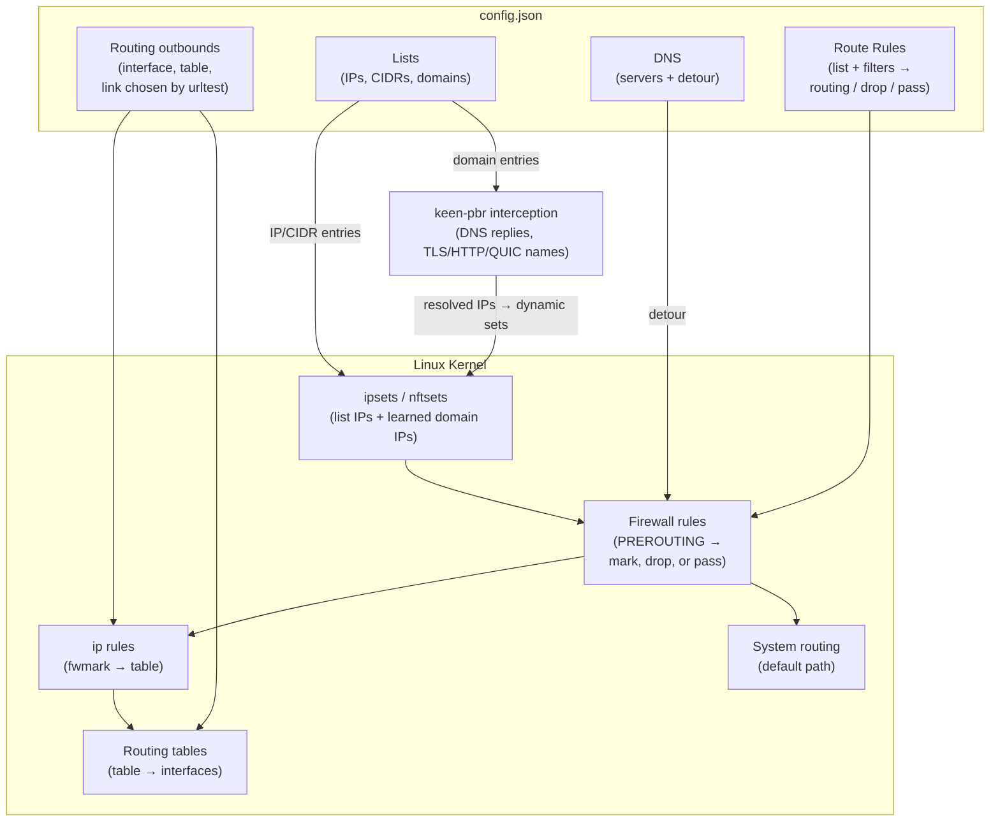
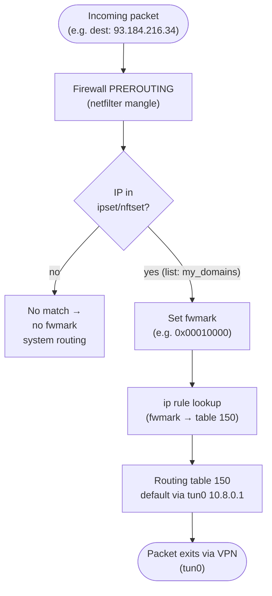
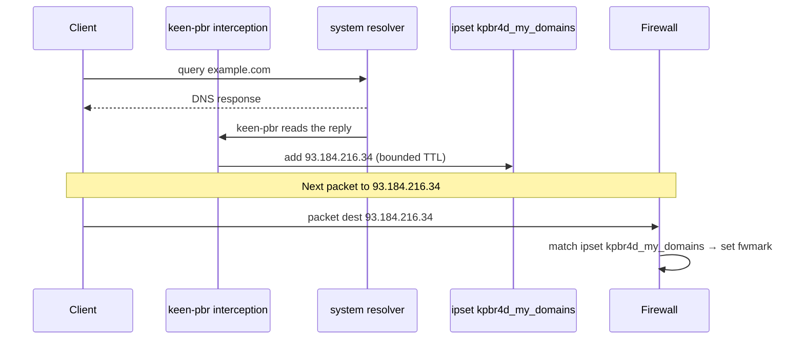

You do not need this page to finish a normal setup.

The short version is simple: you create a list of sites, choose which connection should carry them, and keen-pbr keeps DNS and routing in sync so the right traffic uses the right path.

This page explains what happens under the hood for readers who want the deeper technical model.

## Core Entities

### Lists

Named collections of IPs, CIDRs, and domain names. Sources can be combined freely:
- **Remote URL** (`url`) — downloaded and cached at startup, refreshed on schedule
- **Inline IPs/CIDRs** (`ip_cidrs`) — loaded directly from config
- **Inline domains** (`domains`) — loaded directly from config
- **Local file** (`file`) — read from disk

At startup, IP addresses and subnets from lists are loaded into kernel sets ( or nftables sets) named like `kpbr4_<list>` and `kpbr6_<list>`. These entries stay until the list changes. With iptables, keen-pbr keeps two sets per list (`kpbr4s_`/`kpbr4S_`) and swaps between them on update, so rules are never left without data.

IP addresses of domains are collected from DNS replies and connections passing through the router and added to separate `kpbr4d_<list>` and `kpbr6d_<list>` sets. These are called **dynamic sets**: each address in them is kept for a limited time () and then removed.

See [Lists]() for the full reference.

### Outbounds

Named egress targets. Six types:

| Type | Description |
|---|---|
| `interface` | Route via a specific network interface and optional IPv4/IPv6 gateways |
| `table` | Defer to an existing kernel routing table |
| `blackhole` | Drop matching traffic |
| `ignore` | Pass through without modification (uses default route) |
| `urltest` | Automatic selection: checks links with an HTTP request and picks the fastest one or spreads connections between them; an unstable link is temporarily excluded |
| `icmptest` | Same as `urltest`, but links are checked with ping () |

`interface` and `table` outbounds get fwmarks and policy-routing entries. `urltest` and `icmptest` pick one of their links, which are such outbounds. `blackhole` becomes a firewall drop rule, and `ignore` becomes a firewall pass-through rule.

Traffic sent to `ignore` gets no , and the rules below are not checked for it, so it follows the router's normal routing. `ignore` is used for exceptions: put such a rule above a broader one.

See [Outbounds]() for the full reference.

### Route Rules

An ordered list of match → action pairs. Each rule can match traffic by:
- **List membership** — IP is in a named /nftset
- **Protocol** (`proto`) — `tcp`, `udp`
- **Port filters** (`src_port`, `dest_port`) — single, list, range, or negation
- **Address filters** (`src_addr`, `dest_addr`) — , list, or negation

If a rule specifies multiple match fields, a packet must satisfy ALL specified conditions for the rule to match.

First matching rule wins. Unmatched traffic gets no  and follows the system's normal routing.

See [Route Rules]() for the full reference.

### DNS

Domain routing does not need any resolver setup: dnsmasq, the Keenetic DNS proxy or any other resolver keeps working as you set it up. keen-pbr reads DNS replies passing through the router and site names in TLS, HTTP and  connections, and adds matching IPs to the list's set so the following packets are routed correctly.

With [per-list DNS servers]() (via dnsmasq), domains from specific lists can be resolved through other DNS servers, for example to get CDN addresses for the right region.

See [DNS]() for the full reference.

---

## fwmark and conntrack

keen-pbr relies on two standard Linux kernel mechanisms. Knowing their names helps when reading logs and searching for help.

- **fwmark** (firewall mark) is a number the kernel attaches to a packet. keen-pbr's firewall rules set a  on matching packets, and `ip rule` entries such as `fwmark 0x00010000 lookup 150` send packets with that mark to the outbound's routing table. Each outbound gets its own fwmark from the range set in [`fwmark`]().
- **conntrack** (connection tracking) is the kernel's table of open connections. keen-pbr copies a packet's fwmark into the connection's mark (**connmark**) and restores it on later packets, so a whole connection keeps the same route even after the outbound or the lists change. When keen-pbr needs connections to move to another link, it deletes their  entries.

## How It Works — Startup Sequence

1. **Load lists** — download remote URLs (using cache if unavailable), read local files and inline entries
2. **Fill sets** — IP addresses and subnets are loaded into ipsets or nftables sets
3. **Install firewall rules** — create rules in the `iptables` `mangle` table or the `nftables` `inet KeenPbrTable` table that match configured lists and filters, then set the appropriate  in `PREROUTING` / `prerouting`
4. **Install routing** — create routing tables and `ip rule` entries for each outbound based on assigned fwmarks
5. **Start interception** — keen-pbr starts reading DNS replies and site names in connections (if the kernel supports it)
6. **Start link checks** — if `urltest` or `icmptest` outbounds are configured, periodic checks begin

---

## Architecture Overview

---

## Runtime Packet Flow

---

## DNS Resolution Flow

