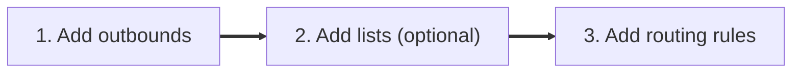

# Quick Start

After this guide, one test site opens through your VPN and the rest of your traffic goes the usual way. You need a VPN interface that already exists on the router (for example `tun0` or `wg0`).


If you do not have a VPN on the router yet, set it up with the guide for your system: [Keenetic / NetCraze](https://help.keenetic.com/hc/en-us/articles/360010592379), [OpenWrt](https://openwrt.org/docs/guide-user/services/vpn/wireguard/start), [Debian](https://wiki.debian.org/WireGuard). In the keen-pbr web UI you pick the interface from a list. To see all interface names in the console, run `ip addr`: the VPN interface is the one with an address from your VPN network.


If you installed the full package, start with the Web UI. If you have `keen-pbr-headless` or prefer editing files, use the JSON tab.

Setup takes three steps:



Three terms you will meet below:

- **outbound** is a channel traffic goes through: a VPN interface, your normal provider connection, or a block;
- **list** is a set of domains and IP addresses, for example "sites that must go through the VPN";
- **routing rule** links the two: "traffic from this list goes to this outbound".

The default config already has the outbounds `wan` (the normal internet connection through your provider), `block` and `direct_local`, plus the list `local_networks` with a rule that keeps your home network local. You only need to create the `vpn` outbound, one list and one rule.





If you have installed `keen-pbr-headless`, see **JSON** configuration method.


<p>
    <figure class="video">
        <video
        controls
        playsinline
        preload="metadata"
        style="width: 100%; border-radius: 12px;"
        >
        <source src="/docs/getting-started/quick-start-video.mp4" type="video/mp4">
        Your browser does not support the video tag.
        </video>
    </figure>
</p>

{}
### Open the Web UI

Open `http://<router-ip>:12121/` in your browser (replace `<router-ip>` with your router IP address).


Tip: On Keenetic / NetCraze you can also open http://my.keenetic.net:12121/.


### Create the VPN outbound

1. Open **Routing** > **Outbounds** and click **Add outbound**.
2. In **Name**, enter `vpn`.
3. In **Type**, choose **Interface**.
4. In **Interface**, pick your VPN interface name from the list.
5. Leave **Default gateway IPv4** and **Default gateway IPv6** empty. A gateway is the address of the next router on the path; VPN tunnels usually do not need one. If you fill in only one of the fields, traffic of the other kind (IPv4 or IPv6) will not go through this outbound.
6. Click **Create outbound**.

The `wan` outbound already exists: it is the normal internet connection through your provider (routing table 254). If it is missing, create it: **Type** > **Routing table**, **Table ID** `254`.

### Create a test list

1. Open **Routing** > **Lists** and click **Add list**.
2. In **Name**, enter `my_sites`.
3. In **Source type**, choose **Domains / IPs**.
4. In **Domains**, enter `ifconfig.co`. For a real service like YouTube one domain is not enough: use a ready-made list, see [Remote URL list]().
5. Click **Create list**.

### Add a routing rule

1. Open **Routing** > **Routing rules** and click **Add routing rule**.
2. Click **Choose the first condition**, choose **Lists** and select `my_sites`.
3. In **Route traffic through**, choose `vpn`.
4. Click **Create rule**.

The new rule appears below the `local_networks` rule. Rules are checked from top to bottom, and the first matching rule wins.

### Apply the changes

A banner appears at the top of the page: "Configuration was changed. Save it to disk to apply it." Click **Apply** and wait until the banner disappears.

### Check the result

1. Clear the DNS cache on your device:
    - On Windows, open Command Prompt and run `ipconfig /flushdns`.
    - On Linux, open a terminal and run `sudo resolvectl flush-caches`.
    - On mobile devices, reconnect to Wi-Fi.
2. Open `ifconfig.co` and compare the IP address with the one an ordinary "my IP" website shows (for example `wtfismyip.com`). If the addresses differ, `ifconfig.co` goes through the VPN.

   Check from a computer or phone on your network, not with `curl` on the router itself: by default the router's own traffic bypasses the rules. More: [FAQ]().
3. To check from the command line, run this on the router:

```bash {filename="bash"}
keen-pbr test-routing ifconfig.co
```

In the result table, the `Expected Outbound` and `Actual Outbound` columns should show `vpn`, and the last column should show `OK`.

{}




Use this path if you installed `keen-pbr-headless` or prefer editing the config file directly.

Config file locations:

- Keenetic / NetCraze: `/opt/etc/keen-pbr/config.json`
- OpenWrt: `/etc/keen-pbr/config.json`
- Debian: `/etc/keen-pbr/config.json`

The file already has the outbounds `wan`, `block` and `direct_local`, the list `local_networks` and its rule. Add the `vpn` outbound, lists and rules as in the example below. Leave the other sections (`daemon`, `dns`, `fwmark`, `iproute`, `lists_autoupdate`, `api`) as they are.

```json {filename="config.json"}
{
  "version": "3.4.0",
  // Outbounds are the channels your traffic can go through
  "outbounds": [
    {
      "tag": "vpn",          // outbound name: letters, digits and underscore
      "type": "interface",   // traffic goes through a network interface
      "interface": "tun0"    // your VPN interface name; a tunnel usually needs no gateway
    },
    {
      "tag": "wan",
      "type": "table",  // traffic follows one of the router's routing tables
      "table": 254      // 254 is the router's main table: the normal internet path through your provider
    },
    {
      "tag": "block",
      "type": "blackhole"  // traffic is dropped
    },
    {
      "tag": "direct_local",
      "type": "ignore"  // traffic goes the usual way; keeps local networks out of the tunnel
    }
  ],
  "lists": {
    "local_networks": { // default list: local and special networks
      "ip_cidrs": [
        "0.0.0.0/8", "10.0.0.0/8", "100.64.0.0/10", "127.0.0.0/8",
        "169.254.0.0/16", "172.16.0.0/12", "192.168.0.0/16",
        "224.0.0.0/4", "240.0.0.0/4", "::1/128", "fc00::/7", "fe80::/10", "ff00::/8"
      ]
    },
    "my_sites": {   // list with domains written in the config
      "domains": ["ifconfig.co"],
      "ttl_ms": 3600000 // minimum time in ms an IP learned from a DNS reply stays in the list; the DNS TTL can extend it up to 24 hours
    },
    "always_wan": { // list with IPs written in the config
      "ip_cidrs": ["120.131.22.11"]
    },
    "my_remote_list": { // list downloaded from a URL
      "url": "https://example.com/my-list.lst"
    },
    "my_local_file_list": { // list read from a file on the router
      "file": "/etc/keen-pbr/local.lst" // use the path to your own file
    }
  },
  "route": {
    "rules": [
      { // Default rule: local networks never go into the tunnel
        "list": ["local_networks"],
        "outbound": "direct_local"
      },
      { // Domains and IPs from "my_sites" go through "vpn"
        "list": ["my_sites"],
        "outbound": "vpn"
      },
      { // IPs from "always_wan" go through "wan", that is, directly through your provider
        "list": ["always_wan"],
        "outbound": "wan"
      }
    ]
  }
}
```


A gateway is the address of the next router on the path. For tunnels such as `tun0` or `wg0`, `gateway` and `gateway6` are usually not needed: if you set neither, both IPv4 and IPv6 traffic goes straight into the interface. If you set only one, the other kind of traffic will not go through this outbound.


What this example does:

- adds the `vpn` outbound for your VPN interface and uses the existing `wan`, `block` and `direct_local`;
- creates the list `my_sites` with `ifconfig.co` and the list `always_wan` with `120.131.22.11`;
- creates the lists `my_remote_list` and `my_local_file_list`; no rule uses them, they are only examples;
- sends domains from `my_sites` through `vpn` and IPs from `always_wan` through `wan`.

Restart the service after saving the config:



```bash {filename="bash"}
/opt/etc/init.d/S80keen-pbr restart
```


```bash {filename="bash"}
service keen-pbr restart
```


```bash {filename="bash"}
systemctl restart keen-pbr
```



Clear the DNS cache on your device (`ipconfig /flushdns` on Windows, `sudo resolvectl flush-caches` on Linux, reconnect to Wi-Fi on a phone), then check the result on the router:

```bash {filename="bash"}
keen-pbr test-routing ifconfig.co
```

The `Expected Outbound` and `Actual Outbound` columns should show `vpn`, and the last column should show `OK`.

For a broader check, run `keen-pbr status`.





All settings are described in [Configuration](); a ready-made example is in [Full Reference Config](). If something does not work, see [Troubleshooting]().


