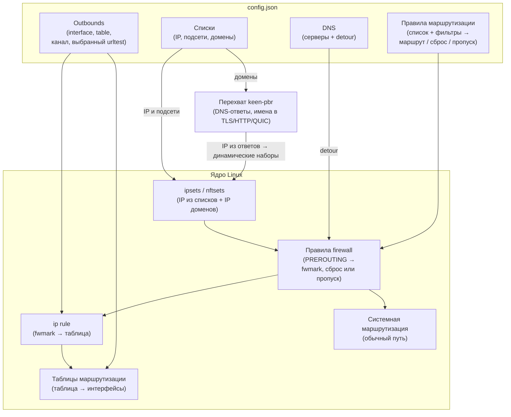
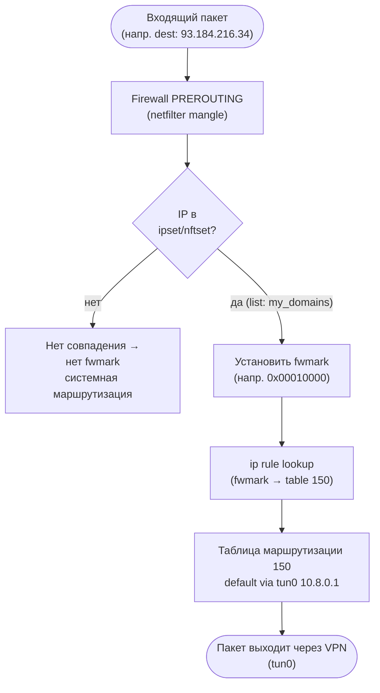
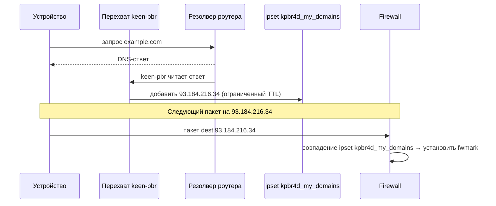

# Принцип работы

Для обычной настройки эту страницу читать необязательно.

Коротко: вы создаёте список сайтов, выбираете, какое соединение должно их обслуживать, а keen-pbr сам следит за тем, чтобы DNS и маршрутизация оставались согласованы и нужный трафик шёл нужным путём.

Эта страница объясняет, что происходит «под капотом», — для тех, кто хочет разобраться глубже.

## Основные сущности

### Списки

Именованные наборы IP-адресов, CIDR-диапазонов и доменных имён. Источники можно комбинировать в любых сочетаниях:
- **Удалённый URL** (`url`) — загружается и кэшируется при запуске, обновляется по расписанию
- **IP/CIDR напрямую** (`ip_cidrs`) — берутся прямо из конфига
- **Домены напрямую** (`domains`) — берутся прямо из конфига
- **Локальный файл** (`file`) — читается с диска

При запуске IP-адреса и подсети из списков загружаются в наборы ядра ( или nftables set) с именами вида `kpbr4_<list>` и `kpbr6_<list>`. Эти записи хранятся, пока список не изменится. С iptables keen-pbr при обновлении держит два набора на список (`kpbr4s_`/`kpbr4S_`) и переключается между ними, чтобы правила не оставались без данных.

IP-адреса доменов keen-pbr берёт из DNS-ответов и соединений, которые проходят через роутер, и добавляет в отдельные наборы `kpbr4d_<list>` и `kpbr6d_<list>`. Такие наборы называются **динамическими**: каждый адрес в них хранится ограниченное время (), а затем удаляется.

См. [Списки]() для полного справочника.

### Outbounds

Именованные цели для исходящего трафика. Доступны шесть типов:

| Тип | Описание |
|---|---|
| `interface` | Маршрутизация через конкретный сетевой интерфейс с необязательными IPv4/IPv6-шлюзами |
| `table` | Передать трафик в существующую таблицу маршрутизации ядра Linux |
| `blackhole` | Отбросить совпавший трафик |
| `ignore` | Пропустить без изменений (пакет идёт по системной маршрутизации) |
| `urltest` | Автоматический выбор: проверяет каналы HTTP-запросом и выбирает самый быстрый или распределяет между ними соединения; нестабильный канал временно исключается |
| `icmptest` | То же, что `urltest`, но каналы проверяются ping-ом () |

Outbounds типа `interface` и `table` получают  и запись в таблице маршрутизации. `urltest` и `icmptest` выбирают один из своих каналов, а каналы — это такие outbounds. `blackhole` создаёт правило сброса пакетов в firewall, `ignore` — правило пропуска.

Трафик, отправленный в `ignore`, не получает , и правила ниже для него уже не проверяются, поэтому он идёт по обычной маршрутизации роутера. `ignore` нужен для исключений: такое правило ставят выше более общего.

См. [Outbounds]() для полного справочника.

### Правила маршрутизации

Упорядоченный список пар «условие → действие». Каждое правило может фильтровать трафик по:
- **Принадлежности к списку** — IP входит в именованный /nftset
- **Протоколу** (`proto`) — `tcp`, `udp`
- **Портам** (`src_port`, `dest_port`) — одиночный, список, диапазон или отрицание
- **Адресам** (`src_addr`, `dest_addr`) — , список или отрицание

Если в правиле указано несколько условий, пакет должен удовлетворять им ВСЕМ.

Срабатывает первое подходящее правило. Трафик, не попавший ни под одно правило, не получает  и идёт через обычную системную маршрутизацию.

См. [Правила маршрутизации]() для полного справочника.

### DNS

Для маршрутизации по доменам резолвер настраивать не нужно: dnsmasq, DNS-прокси Keenetic или любой другой работают так, как вы их настроили. keen-pbr читает DNS-ответы, которые проходят через роутер, и имена сайтов в TLS-, HTTP- и QUIC-соединениях, а подходящие IP добавляет в набор списка, чтобы следующие пакеты пошли нужным маршрутом.

С [отдельными DNS-серверами для списков]() (через dnsmasq) домены из конкретных списков можно разрешать через другие DNS-серверы, например чтобы получать адреса CDN нужного региона.

См. [DNS]() для полного справочника.

---

## fwmark и conntrack

keen-pbr опирается на два стандартных механизма ядра Linux. Их названия пригодятся, когда будете читать логи или искать ответ в интернете.

- **fwmark** (firewall mark) — число, которое ядро хранит вместе с пакетом. Правила firewall keen-pbr ставят  подходящим пакетам, а записи `ip rule` вида `fwmark 0x00010000 lookup 150` отправляют пакеты с этим fwmark в таблицу маршрутизации outbound. У каждого outbound свой fwmark из диапазона, заданного в [`fwmark`]().
- **conntrack** (connection tracking) — таблица открытых соединений в ядре. keen-pbr копирует fwmark пакета в метку соединения (**connmark**) и восстанавливает её на следующих пакетах, поэтому всё соединение идёт одним маршрутом, даже если outbound или списки изменились. Когда соединения нужно перевести на другой канал, keen-pbr удаляет их записи из .

## Как это работает — последовательность запуска

1. **Загрузка списков** — скачиваются удалённые URL (при недоступности берётся кэш), читаются локальные файлы и встроенные записи
2. **Заполнение наборов** — IP-адреса и подсети загружаются в  или nftables set
3. **Настройка правил firewall** — в таблице `mangle` iptables или в таблице `inet KeenPbrTable` nftables создаются правила, которые проверяют списки и фильтры и в `PREROUTING` / `prerouting` ставят нужные 
4. **Настройка маршрутизации** — под каждый outbound создаются таблица маршрутизации и запись `ip rule` на основе назначенных fwmark
5. **Запуск перехвата** — keen-pbr начинает читать DNS-ответы и имена сайтов в соединениях (если ядро это поддерживает)
6. **Запуск проверок каналов** — если настроены outbounds типа `urltest` или `icmptest`, начинаются периодические проверки

---

## Обзор архитектуры

---

## Поток пакета во время выполнения

---

## Поток разрешения DNS

